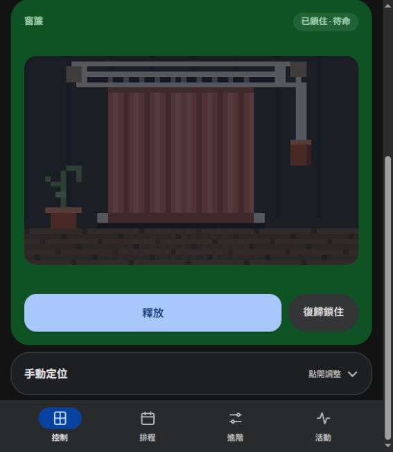

# THOR · 重槌日安

**T**imed **H**ammer **O**pens **R**oom：時間一到，重槌落下，房間就亮了。

一台 300 元台(10美元)以內的自動開窗簾機。ESP8266 控制一顆 SG90 伺服馬達，平常扣住一罐硬幣；手機按「釋放」或排程時間到，扣子打開，硬幣罐往下掉，順勢把窗簾拉開。不用馬達硬拉，所以幾乎沒聲音。

| 手機遙控 | 排程開啟 |
|:---:|:---:|
|  |  |

## 怎麼運作


1. 綠色筒子裡裝 93 個一元硬幣（約 350 g），用繩子連到窗簾。
2. SG90 透過連桿扣住筒子上方的掛頭。
3. 時間到或手機按「釋放」，伺服轉開扣子，筒子落下，窗簾被拉開。
4. 晚上關窗簾時順手把筒子掛回去，幾秒鐘的事。

只負責早上打開；關窗簾還是要手動復位。

控制頁直接放在 ESP8266 上，手機瀏覽器打開就能用：釋放、復歸鎖住、排程（最多 8 組）、手動調角度。畫面裡的像素窗簾會跟著當地天氣變化。



<br clear="right">

## 成本

| 項目 | 金額 |
|---|---|
| ESP8266 開發板（NodeMCU） | 約 120 元 |
| SG90 伺服馬達 | 約 35 元 |
| 配重：93 個一元硬幣 | 93 元 |
| PLA 線材約 77 g | 約 35 元 |
| **合計** | **約 283 元** |


## 資料夾

| 路徑 | 內容 |
|---|---|
| `print/LEFT`、`print/RIGHT` | 列印用 STL，依窗簾拉繩在窗框左邊或右邊選一組 |
| `firmware/` | ESP8266 韌體（Arduino）、建置與無線更新腳本 |
| `web-ui/` | 控制頁原始碼（Apple／Google 兩種風格），`mock_server.py` 可在電腦上模擬 |
| `media/` | README 用的 GIF 與圖片 |

## 自己做一台

**列印**：PLA、零件平放。需要 4 組 M3×15 螺絲與螺帽固定 NodeMCU；SG90 用原附的自攻螺絲。

**接線**：SG90 訊號線接 NodeMCU 的 D5（GPIO14），電源接 5V／GND。

**燒錄**：

1. 安裝 Arduino CLI 與 ESP8266 core 3.1.2，板型 `esp8266:esp8266:nodemcuv2:eesz=4M2M`。
2. 把 `firmware/curtain_controller/secrets.example.h` 複製成 `secrets.h`，填入自己的 Wi-Fi 與更新密碼。
3. 打開 `web-ui/scene.js`，把 `SKY_LOCATION` 改成你家附近的經緯度。
4. 執行：

   ```powershell
   python firmware/build_controller.py --usb COM3
   ```

   會一起燒入韌體和控制頁。之後可在控制頁「進階 → 裝置更新」用 Wi-Fi 更新。

專案路徑有中文時，舊版 ESP8266 工具鏈可能出錯，請把環境變數 `THOR_BUILD` 設成純英文路徑。

## 備註

機構和程式是跟 AI（Codex、Claude Code）邊做邊改出來的，在我家的窗簾上實測可用。每家窗簾的軌道摩擦和行程不同，配重可能要自己加減。
