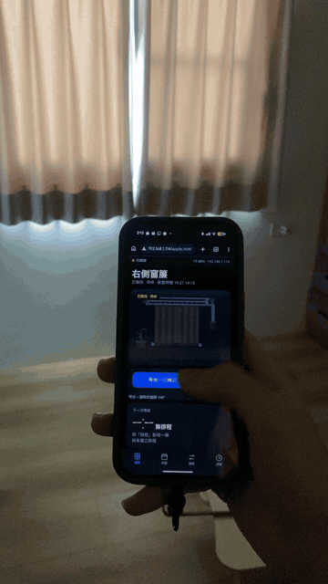
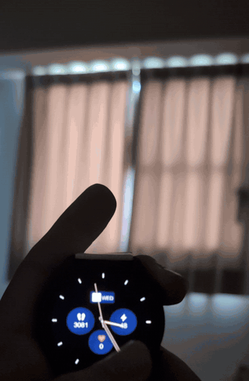
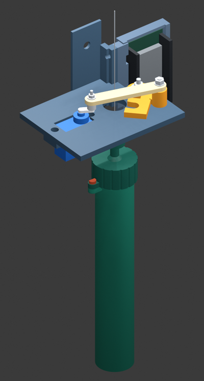
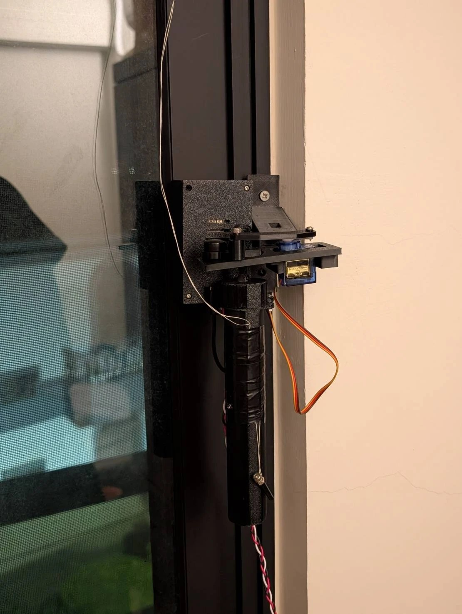
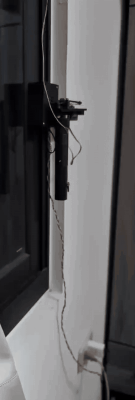
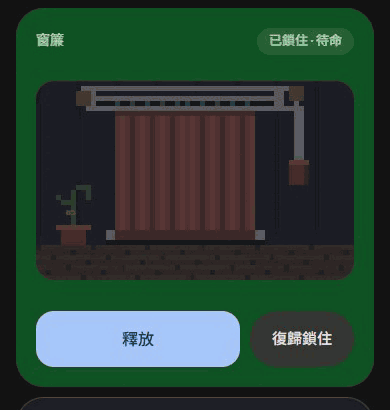

# THOR · 重槌日安

English | [繁體中文](README.zh-TW.md)

**T**imed **H**ammer **O**pens **R**oom: when the time comes, the hammer drops and the room lights up.

An automatic curtain opener for under NT$300 (about US$10). An ESP8266 drives one SG90 servo that holds a canister of coins. Tap "Release" on your phone, or let a schedule fire, and the latch opens. The canister drops and its weight pulls the curtain open. No motor drags the curtain, so it is almost silent.

| Phone control | Scheduled opening |
|:---:|:---:|
|  |  |

## How it works



1. The green canister holds 93 NT$1 coins (about 350 g) and is tied to the curtain.
2. The SG90 holds the hook on top of the canister through a linkage.
3. When the schedule fires or you tap "Release", the servo swings the latch open, the canister falls and the curtain is pulled open.
4. At night, hang the canister back up when you close the curtain. It takes a few seconds.

THOR only opens the curtain in the morning. Closing it is still manual.

<br clear="right">

| Installed on the window frame | Slow motion: the weight drops |
|:---:|:---:|
|  |  |

The control page is served by the ESP8266 itself, so any phone browser on your Wi-Fi works. It has Release, Re-lock, up to 8 schedules and manual servo angle. The pixel-art curtain in the page follows your local weather. The page text is in Chinese.



## Cost

Prices are from Taiwanese shops.

| Item | NT$ | ≈ US$ |
|---|---|---|
| ESP8266 dev board (NodeMCU) | ~120 | ~3.8 |
| SG90 servo | ~35 | ~1.1 |
| Weight: 93 NT$1 coins | 93 | ~3.0 |
| PLA filament, about 77 g | ~35 | ~1.1 |
| **Total** | **~283** | **~9** |

## Folders

| Path | Contents |
|---|---|
| `firmware/` | ESP8266 firmware (Arduino), build and Wi-Fi update scripts |
| `web-ui/` | Control page source (Apple and Google styles). To try it on a computer, run `build.py`, then `mock_server.py`, and open the address it prints |
| `media/` | GIFs and images for this README |

## Build your own

**3D model**: The printable files are on MakerWorld. Search for this project on [makerworld.com/zh/@OuterSky](https://makerworld.com/zh/@OuterSky). There are left and right versions; pick the one that matches the side of the window frame your curtain pull is on.

**Print**: PLA, parts laid flat. You need 4 sets of M3×15 screws and nuts for the NodeMCU. The SG90 uses its own self-tapping screws.

**Wiring**: SG90 signal to NodeMCU D5 (GPIO14), power to 5V / GND.

**Flashing**:

1. Install Arduino CLI and ESP8266 core 3.1.2. Board: `esp8266:esp8266:nodemcuv2:eesz=4M2M`.
2. Copy `firmware/curtain_controller/secrets.example.h` to `secrets.h` and fill in your Wi-Fi and update passwords.
3. In `web-ui/scene.js`, set `SKY_LOCATION` to the latitude and longitude of your home.
4. Run:

   ```powershell
   python firmware/build_controller.py --usb COM3
   ```

   This flashes both the firmware and the control page. Later updates can go over Wi-Fi from the control page under Advanced → Device update.

If the project path contains non-ASCII characters, the older ESP8266 toolchain may fail. Set the `THOR_BUILD` environment variable to an ASCII-only path.

## Notes

The mechanism and code were built step by step with AI (Codex and Claude Code) and tested on the curtains in my home. Every curtain track has different friction and travel, so you may need to add or remove weight.
